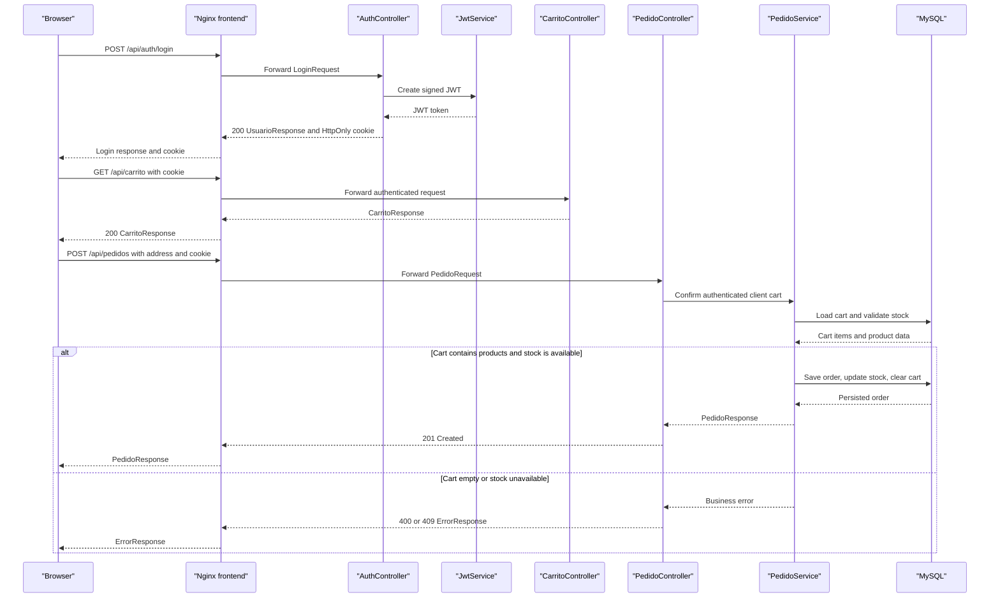

# API & Service Communication Contracts

La API publica 62 endpoints REST para autenticación, catálogo, perfil, carrito, compras, vendedores y administración. La comunicación navegador-servidor es síncrona por HTTP/JSON y el frontend utiliza Nginx para enviar `/api` al backend.

## Service Catalog

| Servicio | Puerto | Categoría | Propósito |
|---|---:|---|---|
| `frontend` | 3000 (host), 80 (container) | API Layer / UI | Aplicación React; Nginx sirve la SPA y hace reverse proxy de `/api` al backend. |
| `backend` (`digital`) | 8080 | API Layer / Business | API REST Spring Boot para autenticación y operaciones del negocio. |
| `mysql` | 3308 (host), 3306 (container) | Infrastructure | Persistencia relacional MySQL. |
| `adminer` | 8081 (host), 8080 (container) | Infrastructure | Interfaz web opcional para inspeccionar MySQL. |

`frontend` y `backend` se construyen desde el repositorio. MySQL y Adminer son imágenes de terceros.

## API Endpoints Inventory

Base local: `http://localhost:3000/api` (mismo origen a través de Nginx), o `http://localhost:8080/api` para acceder directamente al backend. No hay versionado de API en la URL.

Todas las rutas de la tabla son relativas al host indicado. `CLIENTE`, `VENDEDOR`, `ADMIN` y `Autenticado` describen el acceso requerido. Los endpoints de creación devuelven `201 Created` y el recurso; la mayoría de lecturas, actualizaciones y eliminaciones devuelven `200 OK`. El cierre de sesión devuelve `204 No Content`.

Los parámetros de paginación siguen `page` (base cero), `size` y `sort` con la convención Spring Data. Los filtros de consulta no especificados como obligatorios son opcionales.

| Controller | Método | Ruta | Acceso | Query / Path / Body | Respuesta |
|---|---|---|---|---|---|
| AuthController | POST | `/api/auth/registro` | Público | Body `RegistroRequest` | `UsuarioResponse`, 201 |
| AuthController | POST | `/api/auth/registro-vendedor` | Público | Body `RegistroVendedorRequest` | `UsuarioResponse` inactivo, 201 |
| AuthController | POST | `/api/auth/login` | Público | Body `LoginRequest` | `UsuarioResponse`, 200; instala cookie JWT |
| AuthController | POST | `/api/auth/logout` | Público | Sin body | Sin body, 204; expira cookie JWT |
| CatalogoController | GET | `/api/categorias` | Público | Sin parámetros | `List<CategoriaResponse>` |
| CatalogoController | GET | `/api/categorias/{idCategoria}/subcategorias` | Público | Path `idCategoria` | `List<SubcategoriaResponse>` |
| CatalogoController | GET | `/api/productos` | Público | Query `texto`, `idCategoria`, `idSubcategoria`, `page`, `size`, `sort` | `PageResponse<ProductoResponse>` |
| CatalogoController | GET | `/api/productos/{idProducto}` | Público | Path `idProducto` | `ProductoResponse` |
| PerfilController | GET | `/api/usuarios/me` | Autenticado | Sin parámetros | `UsuarioResponse` |
| PerfilController | PUT | `/api/usuarios/me` | Autenticado | Body `UsuarioUpdateRequest` | `UsuarioResponse` |
| UsuarioImagenController | PUT | `/api/usuarios/me/foto` | Autenticado | Multipart file field `archivo` | `UsuarioResponse` |
| UsuarioImagenController | DELETE | `/api/usuarios/me/foto` | Autenticado | Sin body | `UsuarioResponse` |
| CarritoController | GET | `/api/carrito` | CLIENTE | Sin parámetros | `CarritoResponse` |
| CarritoController | POST | `/api/carrito/items` | CLIENTE | Body `CarritoItemRequest` | `CarritoResponse` |
| CarritoController | PUT | `/api/carrito/items/{idItem}` | CLIENTE | Path `idItem`; body `CarritoItemCantidadRequest` | `CarritoResponse` |
| CarritoController | DELETE | `/api/carrito/items/{idItem}` | CLIENTE | Path `idItem` | `CarritoResponse` |
| CarritoController | DELETE | `/api/carrito` | CLIENTE | Sin body | `CarritoResponse` |
| PedidoController | POST | `/api/pedidos` | CLIENTE | Body `PedidoRequest`; el carrito debe tener productos | `PedidoResponse`, 201 |
| PedidoController | GET | `/api/pedidos` | CLIENTE | Query `page`, `size`, `sort` | `PageResponse<PedidoResumenResponse>` |
| PedidoController | GET | `/api/pedidos/{idPedido}` | CLIENTE | Path `idPedido`; solo pedido propio | `PedidoResponse` |
| PagoController | POST | `/api/pedidos/{idPedido}/pagos` | CLIENTE | Path `idPedido`; body `PagoRequest` | `PagoResponse`, 201 |
| PagoController | GET | `/api/pedidos/{idPedido}/pagos` | CLIENTE | Path `idPedido`; solo pedido propio | `List<PagoResponse>` |
| PagoController | GET | `/api/pagos/{idPago}` | CLIENTE | Path `idPago`; solo pago propio | `PagoResponse` |
| ComprobanteController | GET | `/api/comprobantes` | CLIENTE | Query `page`, `size`, `sort` | `PageResponse<ComprobanteResponse>` |
| ComprobanteController | GET | `/api/comprobantes/{idComprobante}` | CLIENTE | Path `idComprobante`; solo comprobante propio | `ComprobanteResponse` |
| AdminCategoriaController | GET | `/api/admin/categorias` | ADMIN | Sin parámetros | `List<CategoriaResponse>` |
| AdminCategoriaController | GET | `/api/admin/categorias/{idCategoria}` | ADMIN | Path `idCategoria` | `CategoriaResponse` |
| AdminCategoriaController | POST | `/api/admin/categorias` | ADMIN | Body `CategoriaRequest` | `CategoriaResponse`, 201 |
| AdminCategoriaController | PUT | `/api/admin/categorias/{idCategoria}` | ADMIN | Path `idCategoria`; body `CategoriaRequest` | `CategoriaResponse` |
| AdminCategoriaController | PATCH | `/api/admin/categorias/{idCategoria}/activar` | ADMIN | Path `idCategoria`; sin body | `CategoriaResponse` |
| AdminCategoriaController | PATCH | `/api/admin/categorias/{idCategoria}/desactivar` | ADMIN | Path `idCategoria`; sin body | `CategoriaResponse` |
| AdminSubcategoriaController | GET | `/api/admin/categorias/{idCategoria}/subcategorias` | ADMIN | Path `idCategoria` | `List<SubcategoriaResponse>` |
| AdminSubcategoriaController | GET | `/api/admin/subcategorias/{idSubcategoria}` | ADMIN | Path `idSubcategoria` | `SubcategoriaResponse` |
| AdminSubcategoriaController | POST | `/api/admin/subcategorias` | ADMIN | Body `SubcategoriaRequest` | `SubcategoriaResponse`, 201 |
| AdminSubcategoriaController | PUT | `/api/admin/subcategorias/{idSubcategoria}` | ADMIN | Path `idSubcategoria`; body `SubcategoriaRequest` | `SubcategoriaResponse` |
| AdminSubcategoriaController | PATCH | `/api/admin/subcategorias/{idSubcategoria}/activar` | ADMIN | Path `idSubcategoria`; sin body | `SubcategoriaResponse` |
| AdminSubcategoriaController | PATCH | `/api/admin/subcategorias/{idSubcategoria}/desactivar` | ADMIN | Path `idSubcategoria`; sin body | `SubcategoriaResponse` |
| AdminProductoController | GET | `/api/admin/productos` | ADMIN | Query `texto`, `idCategoria`, `idSubcategoria`, `page`, `size`, `sort` | `PageResponse<ProductoResponse>` |
| AdminProductoController | GET | `/api/admin/productos/{idProducto}` | ADMIN | Path `idProducto` | `ProductoResponse` |
| AdminProductoController | POST | `/api/admin/productos` | ADMIN | Body `ProductoRequest` | `ProductoResponse`, 201 |
| AdminProductoController | PUT | `/api/admin/productos/{idProducto}` | ADMIN | Path `idProducto`; body `ProductoRequest` | `ProductoResponse` |
| AdminProductoController | PATCH | `/api/admin/productos/{idProducto}/activar` | ADMIN | Path `idProducto`; sin body | `ProductoResponse` |
| AdminProductoController | PATCH | `/api/admin/productos/{idProducto}/desactivar` | ADMIN | Path `idProducto`; sin body | `ProductoResponse` |
| ProductoImagenAdminController | PUT | `/api/admin/productos/{idProducto}/imagen` | ADMIN | Path `idProducto`; multipart file field `archivo` | `ProductoResponse` |
| ProductoImagenAdminController | DELETE | `/api/admin/productos/{idProducto}/imagen` | ADMIN | Path `idProducto`; sin body | `ProductoResponse` |
| VendedorProductoController | GET | `/api/vendedor/productos` | VENDEDOR | Sin parámetros; solo publicaciones propias | `List<ProductoResponse>` |
| VendedorProductoController | POST | `/api/vendedor/productos` | VENDEDOR | Body `ProductoVendedorRequest` | `ProductoResponse` inactivo, 201 |
| VendedorProductoController | PUT | `/api/vendedor/productos/{idProducto}` | VENDEDOR | Path `idProducto`; body `ProductoVendedorRequest`; solo producto propio | `ProductoResponse` inactivo |
| VendedorProductoController | PUT | `/api/vendedor/productos/{idProducto}/imagen` | VENDEDOR | Path `idProducto`; multipart file field `archivo`; solo producto propio | `ProductoResponse` |
| AdminUsuarioController | GET | `/api/admin/usuarios` | ADMIN | Query opcional `rol`, `page`, `size`, `sort` | `PageResponse<UsuarioResponse>` |
| AdminUsuarioController | GET | `/api/admin/usuarios/{idUsuario}` | ADMIN | Path `idUsuario` | `UsuarioResponse` |
| AdminUsuarioController | POST | `/api/admin/usuarios` | ADMIN | Body `UsuarioAdminRequest` | `UsuarioResponse`, 201 |
| AdminUsuarioController | PATCH | `/api/admin/usuarios/{idUsuario}/estado` | ADMIN | Path `idUsuario`; body `UsuarioEstadoRequest` | `UsuarioResponse` |
| AdminPedidoController | GET | `/api/admin/pedidos` | ADMIN | Query opcional `desde`, `hasta`, `estado`, `idUsuario`, `page`, `size`, `sort` | `PageResponse<PedidoResumenResponse>` |
| AdminPedidoController | GET | `/api/admin/pedidos/{idPedido}` | ADMIN | Path `idPedido` | `PedidoResponse` |
| AdminPedidoController | PATCH | `/api/admin/pedidos/{idPedido}/estado` | ADMIN | Path `idPedido`; body `CambioEstadoPedidoRequest` | `PedidoResponse` |
| AdminPedidoController | GET | `/api/admin/pedidos/{idPedido}/pagos` | ADMIN | Path `idPedido` | `List<PagoResponse>` |
| AdminPedidoController | POST | `/api/admin/pedidos/{idPedido}/pagos` | ADMIN | Path `idPedido`; body `PagoRequest` | `PagoResponse`, 201 |
| AdminPagoController | GET | `/api/admin/pagos/{idPago}` | ADMIN | Path `idPago` | `PagoResponse` |
| AdminPagoController | PATCH | `/api/admin/pagos/{idPago}/estado` | ADMIN | Path `idPago`; body `CambioEstadoPagoRequest` | `PagoResponse` |
| AdminComprobanteController | GET | `/api/admin/comprobantes` | ADMIN | Query `page`, `size`, `sort` | `PageResponse<ComprobanteResponse>` |
| AdminComprobanteController | GET | `/api/admin/comprobantes/{idComprobante}` | ADMIN | Path `idComprobante` | `ComprobanteResponse` |

## Request Bodies

Los siguientes ejemplos son JSON (`Content-Type: application/json`). Los campos opcionales pueden omitirse o enviarse como `null`; los requeridos se validan en el backend. No se envían precios ni líneas de pedido al confirmar una compra: el servidor los obtiene del carrito y del catálogo.

### Usuarios de prueba persistidos

Docker Compose crea estas cuentas de forma idempotente al iniciar el backend. El sembrado conserva cualquier cuenta existente y no sobrescribe sus contraseñas. Las claves están en el archivo local `.env`, ignorado por Git; consultar la variable indicada, no copiarlas a documentación versionada.

| Email | Rol | Contraseña local |
|---|---|---|
| `admin1@corralon.local` | ADMIN | `SEED_ADMIN1_PASSWORD` en `.env` |
| `admin2@corralon.local` | ADMIN | `SEED_ADMIN2_PASSWORD` en `.env` |
| `cliente1@corralon.local` | CLIENTE | `SEED_CLIENT1_PASSWORD` en `.env` |
| `cliente2@corralon.local` | CLIENTE | `SEED_CLIENT2_PASSWORD` en `.env` |

Para iniciar sesión, usar `POST /api/auth/login` con el email y la contraseña de `.env`. Los datos sobreviven a `docker compose down`; `docker compose down -v` elimina el volumen MySQL y las cuentas junto con la base.

### Autenticación y cuenta

`POST /api/auth/registro` — `RegistroRequest`:

```json
{
  "nombre": "Ana",
  "apellido": "Pérez",
  "email": "ana@example.com",
  "password": "Cambiar-esta-clave-123",
  "telefono": "3815550101",
  "direccion": "San Miguel de Tucumán"
}
```

`POST /api/auth/registro-vendedor` — `RegistroVendedorRequest` tiene los mismos datos de contacto y credenciales, pero crea un usuario `VENDEDOR` inactivo:

```json
{
  "nombre": "Vera",
  "apellido": "Vendedora",
  "email": "vera@example.com",
  "password": "Cambiar-esta-clave-123",
  "telefono": "3815550101",
  "direccion": "San Miguel de Tucumán"
}
```

Un administrador lo habilita mediante `PATCH /api/admin/usuarios/{idUsuario}/estado` con `{"activo":true}`. El vendedor usa el mismo `POST /api/auth/login` que los clientes.

`POST /api/vendedor/productos` — `ProductoVendedorRequest` no acepta estado activo. El producto queda pendiente de revisión y solo un administrador puede activarlo con `PATCH /api/admin/productos/{idProducto}/activar`:

```json
{
  "nombre": "Pintura látex interior 20 L",
  "descripcion": "Pintura lavable para interiores",
  "precio": 25999.9,
  "stock": 12,
  "idSubcategoria": 3
}
```

Los vendedores solo pueden consultar y modificar publicaciones propias. Al editar una publicación aprobada, incluida su imagen, vuelve a quedar inactiva para requerir una nueva revisión. Solo se aceptan categorías y subcategorías activas. `ProductoResponse.publicadoPorVendedor` permite al administrador distinguir las publicaciones de vendedor de las creadas desde administración.

`POST /api/auth/login` — `LoginRequest`:

```json
{
  "email": "ana@example.com",
  "password": "Cambiar-esta-clave-123"
}
```

El login establece la cookie `AUTH_TOKEN` (JWT, `HttpOnly`, `SameSite=Lax`). En el navegador se envía automáticamente en las siguientes solicitudes del mismo origen. `POST /api/auth/logout` elimina esa cookie.

`PUT /api/usuarios/me` — `UsuarioUpdateRequest`:

```json
{
  "nombre": "Ana",
  "apellido": "Pérez",
  "telefono": "3815550101",
  "direccion": "Nueva dirección 123"
}
```

### Carrito y compra

`POST /api/carrito/items` — `CarritoItemRequest`:

```json
{
  "idProducto": 12,
  "cantidad": 2
}
```

`PUT /api/carrito/items/{idItem}` — `CarritoItemCantidadRequest`:

```json
{
  "cantidad": 3
}
```

`POST /api/pedidos` — `PedidoRequest`:

```json
{
  "direccionEntrega": "Av. Belgrano 123, San Salvador de Jujuy"
}
```

El carrito debe pertenecer al cliente autenticado y no estar vacío; el backend valida disponibilidad y stock, calcula los importes y vacía el carrito al confirmar.

`POST /api/pedidos/{idPedido}/pagos` y `POST /api/admin/pedidos/{idPedido}/pagos` — `PagoRequest`:

```json
{
  "metodo": "TRANSFERENCIA",
  "importe": 24500.00,
  "referenciaOperacion": "OP-123456"
}
```

El estado inicial del pago es `PENDIENTE`; el cliente no envía el estado.

### Administración de catálogo

`POST /api/admin/categorias` y `PUT /api/admin/categorias/{idCategoria}` — `CategoriaRequest`:

```json
{
  "nombre": "Herramientas",
  "descripcion": "Herramientas manuales y eléctricas",
  "activo": true
}
```

`POST /api/admin/subcategorias` y `PUT /api/admin/subcategorias/{idSubcategoria}` — `SubcategoriaRequest`:

```json
{
  "nombre": "Taladros",
  "descripcion": "Taladros y accesorios",
  "activo": true,
  "idCategoria": 1
}
```

`POST /api/admin/productos` y `PUT /api/admin/productos/{idProducto}` — `ProductoRequest`:

```json
{
  "nombre": "Taladro percutor",
  "descripcion": "Taladro de uso general",
  "precio": 24500.00,
  "stock": 10,
  "activo": true,
  "idSubcategoria": 3
}
```

Para cambiar imágenes se usa `multipart/form-data` con una parte de archivo llamada `archivo`, no JSON. El límite configurado para el archivo es 5 MB.

### Usuarios, pedidos y pagos administrativos

`POST /api/admin/usuarios` — `UsuarioAdminRequest`:

```json
{
  "nombre": "Carlos",
  "apellido": "Administrador",
  "email": "carlos@example.com",
  "password": "Cambiar-esta-clave-123",
  "telefono": "3815550102",
  "direccion": "Jujuy",
  "rol": "CLIENTE"
}
```

Para `rol` se permiten `ADMIN` o `CLIENTE`; use este endpoint solo desde una sesión ADMIN.

`PATCH /api/admin/usuarios/{idUsuario}/estado` — `UsuarioEstadoRequest`:

```json
{
  "activo": false
}
```

`PATCH /api/admin/pedidos/{idPedido}/estado` — `CambioEstadoPedidoRequest`:

```json
{
  "estado": "EN_PREPARACION"
}
```

Los valores definidos para `EstadoPedido` son `PENDIENTE`, `PAGADO`, `EN_PROCESO`, `ENVIADO`, `ENTREGADO`, `CANCELADO`, `CONFIRMADO` y `EN_PREPARACION`. La transición debe estar permitida por las reglas del servidor.

`PATCH /api/admin/pagos/{idPago}/estado` — `CambioEstadoPagoRequest`:

```json
{
  "estado": "APROBADO"
}
```

Los valores definidos para `EstadoPago` son `PENDIENTE`, `APROBADO`, `RECHAZADO` y `REEMBOLSADO`.

## Management & Observability Endpoints

| Servicio | Endpoint | Métricas personalizadas |
|---|---|---|
| Backend | No se encontró configuración de Spring Actuator ni endpoints de health/info/metrics. | No se encontraron métricas personalizadas ni exportador Prometheus. |
| Frontend | Nginx sirve la SPA y proxifica `/api`; no se configuró endpoint de métricas o estado. | No configuradas. |
| Adminer | UI disponible en `/` sobre el puerto host 8081. | No configuradas. |

La API agrega el encabezado `X-Request-ID` a cada respuesta y lo incluye en logs correlacionados de filtros, controladores y servicios.

## DTOs & Contracts

Los request y response DTO son records Java inmutables serializados como JSON por Spring/Jackson. Los requests principales son `RegistroRequest`, `LoginRequest`, `UsuarioUpdateRequest`, `UsuarioAdminRequest`, `UsuarioEstadoRequest`, `CategoriaRequest`, `SubcategoriaRequest`, `ProductoRequest`, `ProductoFiltroRequest`, `CarritoItemRequest`, `CarritoItemCantidadRequest`, `PedidoRequest`, `PedidoFiltroRequest`, `CambioEstadoPedidoRequest`, `PagoRequest` y `CambioEstadoPagoRequest`.

Las respuestas principales son `UsuarioResponse`, `AuthResponse`, `CategoriaResponse`, `SubcategoriaResponse`, `ProductoResponse`, `CarritoResponse`, `CarritoItemResponse`, `PedidoResponse`, `PedidoResumenResponse`, `DetallePedidoResponse`, `PagoResponse`, `ComprobanteResponse`, `ImagenResponse`, `ErrorResponse` y `PageResponse<T>`. `PageResponse<T>` envuelve resultados paginados; no existe un DTO de agregación de gateway. Las entidades de negocio no son el contrato público de request.

Los errores de negocio y validación usan `ErrorResponse` con `timestamp`, `status`, `mensaje` y `detalles`. Según la causa, el API puede devolver 400 (datos inválidos o flujo no permitido), 401 (sin autenticación), 403 (rol insuficiente), 404 (recurso no encontrado), 409 (conflicto) o 413 (archivo demasiado grande). Las operaciones con imágenes también pueden devolver 502 si Cloudinary no está disponible.

No se encontró especificación OpenAPI/Swagger, esquema GraphQL ni contrato protobuf.

## Communication Patterns

- Navegador → Nginx → backend: REST síncrono; Nginx reenvía `/api` a `backend:8080`. El frontend y API comparten origen en Docker.
- Controladores → servicios → repositorios: llamadas directas síncronas dentro del backend; el acceso persistente es MySQL mediante JPA.
- El servicio de imágenes se comunica con Cloudinary para subir y borrar recursos. No se identificaron colas ni procesamiento asíncrono de negocio.
- Spring Cloud Gateway aparece como dependencia Maven, pero no se encontraron rutas configuradas en la aplicación. La función de proxy desplegada corresponde a Nginx.
- No se identificaron circuit breakers, políticas de retry, service discovery ni balanceo client-side configurados.
- Docker Compose inicia MySQL antes del backend y el frontend; el catálogo API no depende de una composición de microservicios.
- La API usa Spring Security stateless y JWT HS256 en cookie `HttpOnly`; endpoints administrativos y de cliente aplican autorización por rol. El entorno local HTTP no usa TLS; configure HTTPS y cookie segura en despliegues productivos.

## Service Technology Matrix

| Servicio | Web | Acceso a datos | Discovery | Gateway | Actuator | Cache | Métricas |
|---|---|---|---|---|---|---|---|
| `frontend` | React + Nginx | — | — | Reverse proxy `/api` | — | — | — |
| `backend` | Spring MVC / REST | Spring Data JPA + MySQL | Ninguno identificado | No hay rutas de Spring Cloud Gateway configuradas | No configurado | No identificado | No identificado |
| `mysql` | — | MySQL 8.4 | DNS de Docker Compose | — | Healthcheck Compose | — | — |
| `adminer` | UI web Adminer | Conexión a MySQL | DNS de Docker Compose | — | — | — | — |

## Service Communication Sequence

<!-- mermaid-checked: every participant uses `participant Id as "Label"`, no \n in aliases/messages/notes, every alt/opt/loop closed by end, no `:` inside any alias -->

